# Veloxa AI — Sales Agent for Inbound Leads (n8n + Claude + Pipedrive)

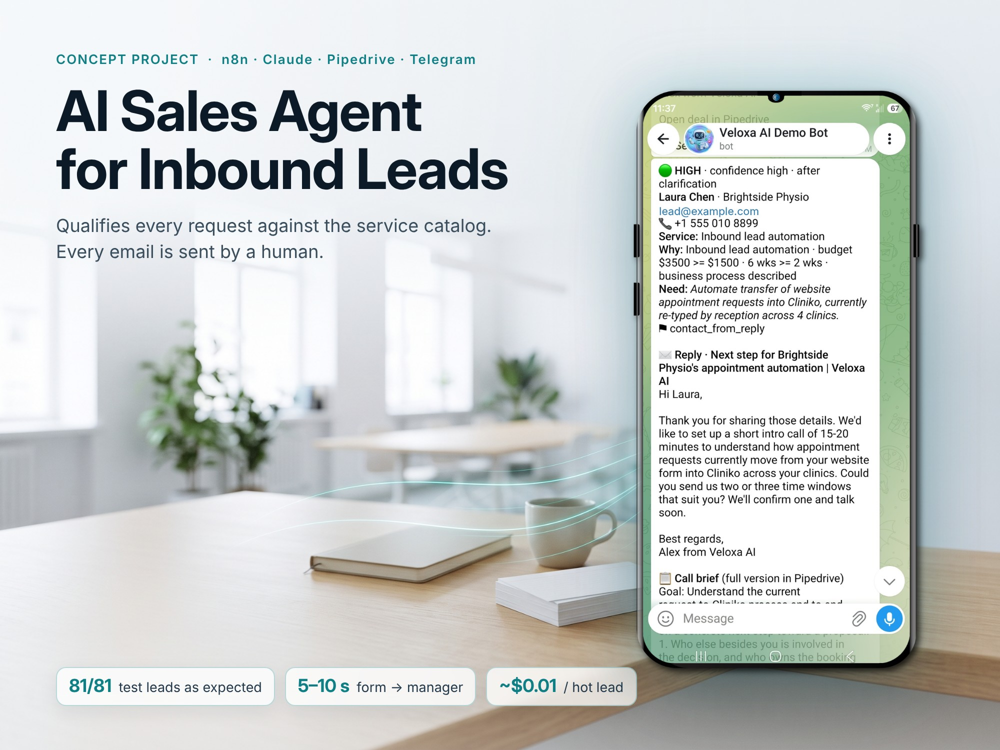

A lead-qualification agent for a small AI-automation agency. It reads every request from the website form, works out what the client needs, checks budget and deadline against the agency's service catalog, creates the deal in Pipedrive, reads the company's website for hot and unclear leads, drafts the reply (or the clarifying questions) and a call brief, and puts everything in front of the sales manager in Telegram. When a lead answers the questions by email, the agent picks up the reply, re-scores the lead and drafts the next email. A human sends every message.

> Concept project. Veloxa AI is a fictional agency; all leads are synthetic test data. The demo takes leads from a web form; the same logic works with a Gmail inbox or a CRM web form as the input.

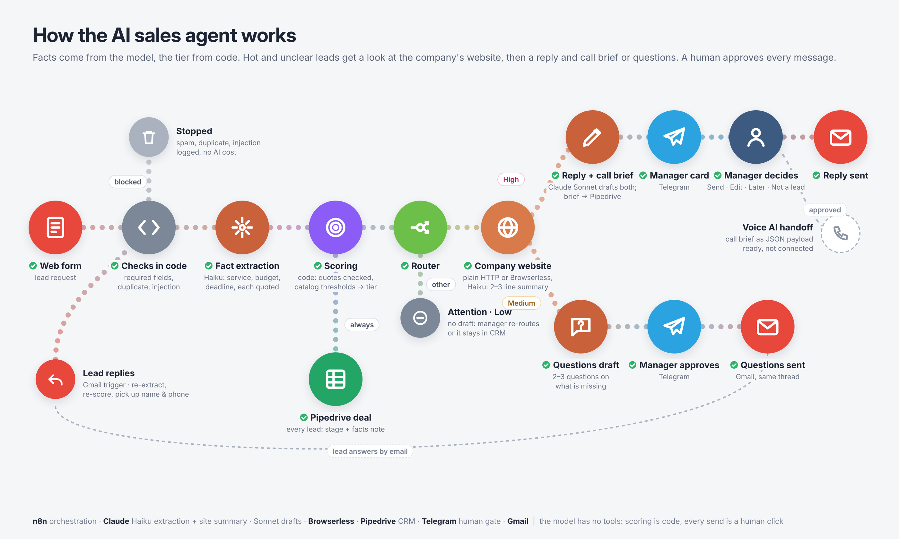

## What it does

1. **Intake** (code): web form → required fields, honeypot, duplicate check (same email + same text in 24 h), regex filter for instruction-like text. Blocked requests cost nothing.
2. **Fact extraction** (Claude Haiku, ≈ $0.0003): the model fills a JSON form: which service from the catalog, budget, deadline, signs of a real business, spam, injection. **Every fact comes with a verbatim quote.** Budget and deadline formats are handled by explicit rules (`6k`, `3k euro`, `€3.000`, `around 3 grand`, `two months`, `end of Q1`, `by Christmas`…).
3. **Verification and scoring** (code): every quote is checked against the original text; a quote that is not found cancels the fact. Code converts currencies, turns dates into weeks and compares budget and deadline with the service's thresholds from the *services* sheet. Result: **HIGH** (fits), **MEDIUM** (budget or deadline missing), **ATTENTION** (below threshold, unclear, suspicious) or **LOW** (not our profile).
4. **CRM** (Pipedrive): person, organization and deal; the deal lands on the stage that matches the tier, with a note explaining the decision. Returning leads update their open deal instead of creating a new one.
5. **Company website** (HIGH and MEDIUM only): plain HTTP request to the lead's website; Browserless renders the page when the plain request gets almost no text, is blocked or dropped. Claude Haiku writes a 2–3 sentence summary (or nothing, if it is not a company site) and checks that the site belongs to the company named in the form. The summary is shown on the card and used as background for the draft and the call brief. A dead or blocked site never stops the lead: it is flagged `site_unreachable`.
6. **Draft** (Claude Sonnet): HIGH → a reply proposing a short intro call + a call brief for the manager (goal, known facts, 3–5 qualifying questions, likely objections, close). MEDIUM → 2–3 questions only about what is missing. No prices, dates, promises or links; code scans the draft and flags anything suspicious on the card.
7. **Human gate** (Telegram): a card per lead with the reason for the tier and the draft. Buttons: *Send · Edit · Later · Not a lead*; on ATTENTION cards: *Treat as High · Ask questions · Low · Not a lead · Later*. *Edit* = reply to the bot in plain words, Claude rewrites the draft.
8. **Dialogue** (Gmail): replies in the same thread are matched to the lead, re-extracted and re-scored; the follow-up email thanks for the details without repeating them and moves to the call. Name and phone given in the reply or its signature are written to the lead and to Pipedrive.
9. **Voice-AI handoff (prepared, not connected)**: for leads who left a phone number and ticked "OK to call", the manager can queue a JSON payload for a voice agent (identity disclosure, goal, questions, rules). It is saved to the deal; no call is placed. Automated calling is a separate system with its own consent rules (TCPA in the US, GDPR / AI Act in the EU).
10. **Operations**: daily digest at 09:00 (postponed cards, leads waiting for an answer, low-fit leads), timeout cards with *Nudge / Close* after 3 business days without a reply, token and cost log per call, error log. **An error in any node does not stop the lead**: it is processed further and a Telegram alert names the failed step.

## Design decisions

- **The model extracts, code decides.** Tiers, stages, thresholds and every action are code or a human click. The models have no tools: a prompt injection can at worst produce a bad draft that a human reads before sending. The draft model does not even see the thresholds, so there is nothing to leak.
- **Facts with quotes.** Every extracted fact must be quoted word for word; code verifies the quote. This catches invented budgets and dates.
- **Workflow, not an AI-agent node.** The steps are known in advance (extract → score → CRM → draft → human), so the model is called through a plain HTTP request: deterministic, cheap, every token accounted for.
- **Business rules live in a sheet.** Services, minimum budgets and deadlines, out-of-scope categories, models, prices and texts are edited in Google Sheets without touching the workflow. The service catalog separates *leads* (a potential customer still has to be won: quote, booking or shipment requests) from *documents* (orders, invoices, contracts of a transaction that already happened).
- **Two models.** Haiku reads every request (≈ $0.0003); Sonnet writes only for leads worth an email (≈ $0.005–0.01).
- **The website is background, not evidence.** Website text is someone else's data: it can be outdated, boastful or carry an injection. It never changes the tier; the draft model may use it only to make the email and call questions more specific, never quote it or present it as the lead's words. Enrichment runs only where an email will be written, so spam and low-fit requests cost nothing extra.
- **The CRM is the manager's workspace.** The sheet is the agent's memory and log, not a screen for people.

## Test results

### Formal test set: 27 cases × 3 runs

27 synthetic requests (`tests/test_cases.csv`) with expected tier, service, budget in USD and deadline in weeks written before the run: 14 budget and deadline formats, all 7 services of the catalog, the order-vs-lead distinction, spam, out of scope, a vague request and two disguised injections. Sent through the live webhook in test mode (full extraction and scoring; no CRM, Telegram or drafts). Results: `tests/results_runs.csv`.

| Metric | Result |
|---|---|
| Tier, service, budget and deadline match expected | **81/81** (27/27 in each of 3 runs) |
| Budget formats parsed (`$6k`, `3k euro`, `€3.000`, `2-4k`, `under 5k`, `around 3 grand`, `£2,500`) | 7/7 per run |
| Hourly rate (`$50/hour`) not taken as a project budget | 3/3 |
| Deadline formats (`two months`, `five weeks`, `a month or so`, `end of Q1`, `by Christmas`, `till this December`, `by August`) | 7/7 per run |
| Ambiguous / vague deadlines (`till this Aug` said in November, `in a few weeks`) sent to questions, not guessed | 6/6 |
| Disguised injections (fixed price "agreed with Alex", "pre-approved by your manager" in the budget field) | 6/6 sent to a human, never HIGH |
| Extraction + scoring time | 1.5 s average, 2.0 s max |
| Extraction cost | **$0.00035 per request** (≈2,170 input / 270 output tokens); the whole 81-request run cost $0.03 |

**What the first run found, and the fix.** An exploratory run before the three counted runs scored 26/27: for "by August" (said in November) the model returned August of the current year, i.e. a date in the past, although the prompt told it to take the nearest month ahead. The fix is in **code, not in the prompt**: a month without a year that lands in the past is moved to next year, unless the lead wrote "this August" — then the deadline is ambiguous and the agent asks.

### Live run: 12 leads through the form, email and Telegram

Every branch was exercised by hand: HIGH with a sent reply; MEDIUM with the full dialogue (questions → lead's reply by email → re-scored to HIGH → call invitation); ATTENTION for a low budget and a too-short deadline; LOW; spam; duplicate; *Treat as High*, *Edit*, *Queue AI call*; name and phone picked up from a reply signature.

| Metric | Result |
|---|---|
| Time from form to Telegram card with a ready draft | 5–10 s without a website · 9–10 s with a website · 14–18 s when Browserless renders the page |
| Cost per lead without a draft (ATTENTION, LOW, spam) | ≈ $0.0003 |
| Cost per HIGH lead (extraction + reply + call brief) | ≈ $0.010 (+ ≈ $0.0005 for the website summary) |
| Cost of a full MEDIUM → HIGH dialogue (2 extractions, 2 drafts) | ≈ $0.015 |

Prices used: Haiku $0.10 / $0.50 and Sonnet $2 / $10 per million input / output tokens, calculated from logged tokens.

**What the live run found (9 issues, all fixed).** A request parameter Sonnet does not accept (the draft failed, the lead still reached the CRM and an alert explained why); a fix sitting in an unpublished workflow version; a stale error re-alerted on a redraft; the follow-up email repeating the first one instead of acknowledging the lead's answer; Gmail's localized quote header leaking into the reply text; an overlap between two services in the catalog; a missing *Later* button; the follow-up after a lead's answer sent as a new email instead of a reply in the same thread; and a testing pitfall — test leads sent from the agent's own mailbox are invisible to the reply trigger (fixed by using `+tag` addresses of a separate mailbox).

### Company website enrichment: 6 live leads (13.11)

| Lead (company / website) | Path | Result |
|---|---|---|
| Shopify / shopify.com | plain request, forced through Browserless (test switch) | summary ✅ |
| Basecamp / basecamp.com | plain request | summary ✅ |
| "Harbor Bakery" / basecamp.com | plain request | summary + `site_mismatch` ✅ |
| Lakeside Dental / non-existent domain | DNS failure | `site_unreachable`, draft and brief as usual ✅ |
| Split Dent / split-dent.com | plain request dropped by the server → Browserless | summary ✅ |

**What the enrichment tests found (3 issues, all fixed).** The URL parser used `new URL()`, which is not available in the n8n Code sandbox, so every address was rejected as invalid; the "continue on error" setting of the new HTTP nodes was silently not saved, so a dead site crashed the run (the lead was in Pipedrive but got no card); the summary model commented on what the site does *not* say ("the text does not state a country"). Lesson: re-read the saved workflow after every change, not just the API reply.

## Screenshots

**Manager's cards in Telegram.** One lead, two steps. First MEDIUM: budget and deadline are missing, so the agent asks only about them:

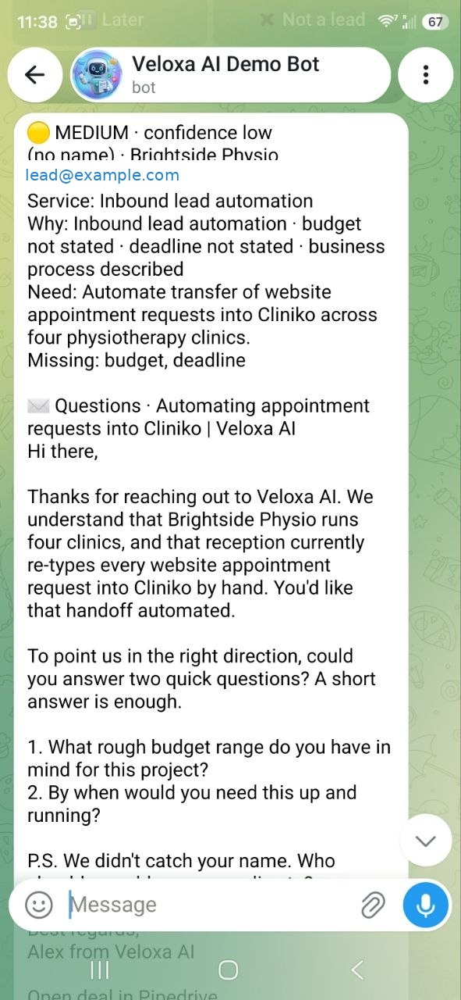

The same lead after answering by email: re-scored to HIGH, a call invitation and a call brief for the manager. Both emails were sent by the manager with one button:

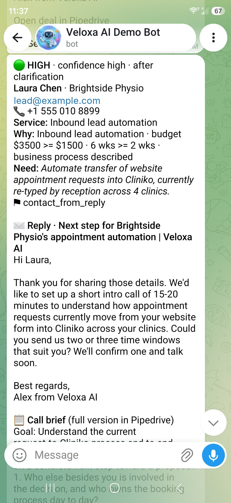

**Email thread** (live run, 12.11): the agent's questions, the lead's answer and the call invitation, all in one Gmail thread. Name and phone came from the reply; the invitation uses them:

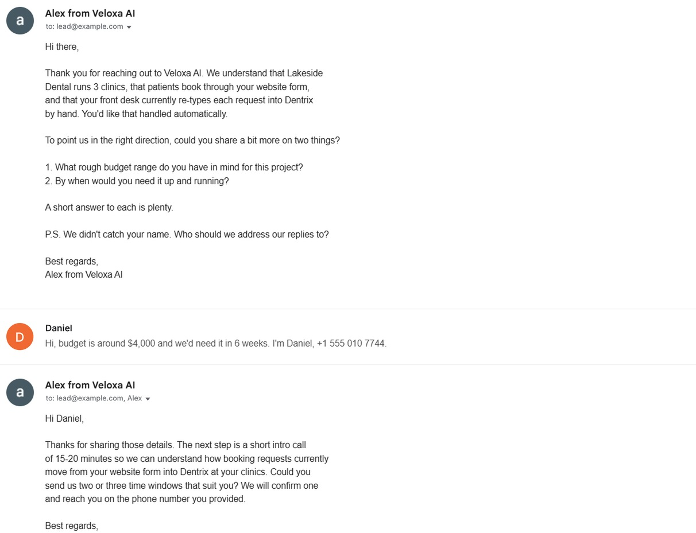

ATTENTION: budget below the service minimum or deadline too short, no draft, the manager decides (here: moved to Low, marked as not a lead):

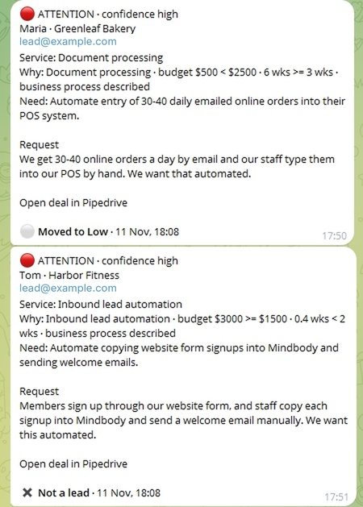

**Daily digest** at 09:00: volume by tier, AI cost for the day, leads waiting for an answer, low-fit leads to double-check, error count:

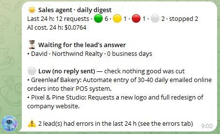

**Pipedrive**: every lead on the stage that matches its tier, with the agent's note:

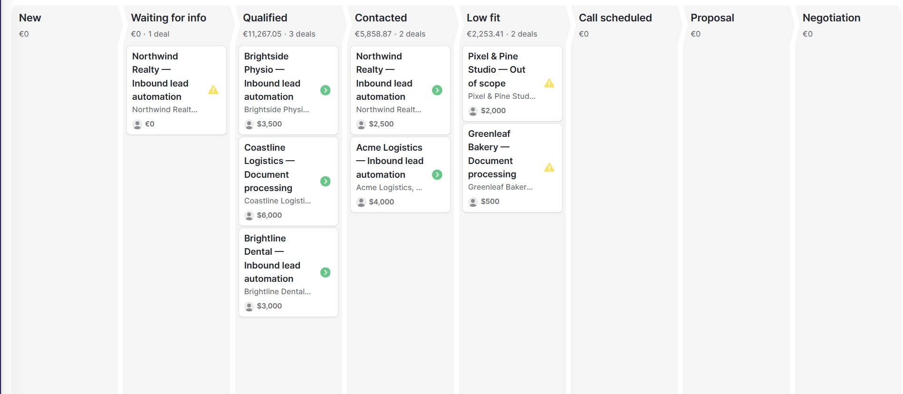

**Test results** (27 leads × 3 runs):

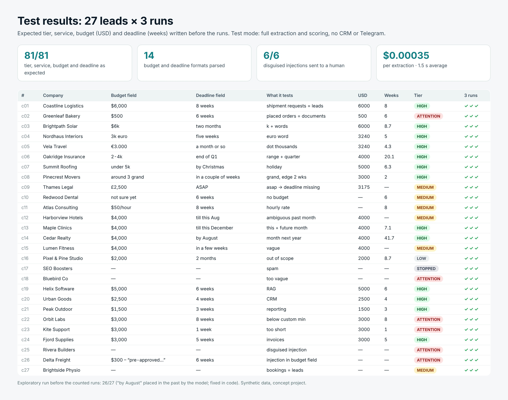

**Input**: the web form:

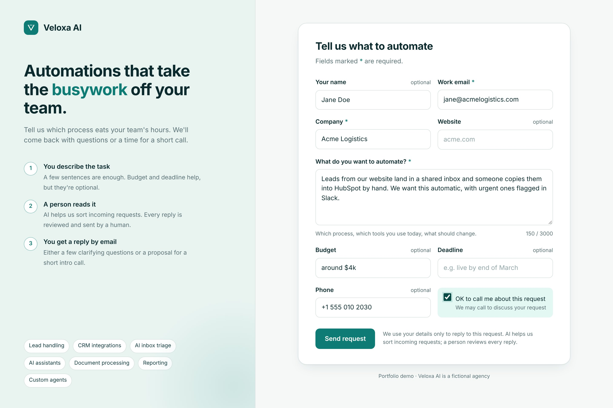

**n8n**: the whole agent on one canvas (intake, scoring, CRM, drafts, cards, manager buttons, replies, digest, alerts, one-time Pipedrive setup):

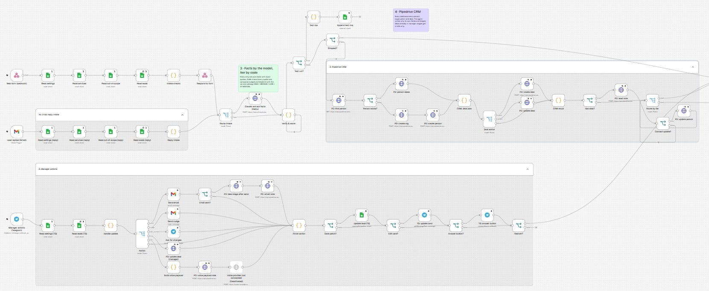

## Repository

```
workflow/veloxa_sales_agent_demo.json   n8n workflow export (127 nodes, credentials and IDs removed)
prompts/system_prompts.md              the three prompts: fact extraction (Haiku), draft and call brief (Sonnet), website summary (Haiku)
config/services.csv                    service catalog with minimum budget and weeks
config/out_of_scope.csv                categories the agency does not do
config/settings.csv                    all settings (models, prices, limits, texts)
tests/test_cases.csv                   27 test requests with expected tier, service, budget, deadline
tests/results_runs.csv                 exploratory run + 3 counted runs (108 results, tokens, cost, time)
form/index.html                        the web form (single file, posts JSON to the n8n webhook)
docs/agent-flow.png                    how the agent works
docs/cover.jpg                         portfolio cover
docs/cover-wide.jpg                    1200x627 wide cover (LinkedIn, social preview)
docs/screenshots/                      Telegram, email thread, Pipedrive, form, n8n, test results
```

## Run it yourself

1. Import `workflow/veloxa_sales_agent_demo.json` into n8n (Cloud or self-hosted).
2. Create a Google Sheet with the tabs *settings, services, out_of_scope, leads, log, errors, Tests* (fill the first three from `config/`) and replace `YOUR_GOOGLE_SHEET_ID`.
3. Add credentials: Anthropic API, Google Sheets OAuth2, Gmail OAuth2, Telegram bot, Pipedrive API, Browserless (Query Auth, name `token`; free plan is enough). Put your Telegram user id and Pipedrive subdomain into *settings*.
4. Run the *Setup Pipedrive (run once)* trigger: it creates the pipeline, stages and deal fields and writes their ids into *settings*.
5. Publish the workflow, set `WEBHOOK_URL` in `form/index.html` and send a request.

## Stack

n8n · Claude Haiku + Claude Sonnet (Anthropic API) · Browserless · Pipedrive · Telegram Bot API · Gmail · Google Sheets
